# Procesing Sentinel-1 data in ESA SNAP Toolbox

You can download the latest version of the ESA SNAP Toolbox [here](https://step.esa.int/main/download/snap-download/). Please note that this readme is written for version 11.0, although the steps may be similar for other (later) versions.

## Downloading Sentinel-1 data

You can download Sentinel-1 (S-1) data from the [Copernicus Browser](https://browser.dataspace.copernicus.eu/), after you sign up. You can upload a GeoJSON with the regions of interest to run inference on. This will expose the S-1 tiles for the regions of interest. We recommend setting the following filters during your search:


- Level-1 GRD COG
- Orbit direction: Ascending
- Relative orbit number: <insert your appropriate orbit number, or leave blank>
- Operational model: IW
- Polarization Channels: VV+VH
- Online: Immediate

Set your time range to the start and end of the season you are interested in.

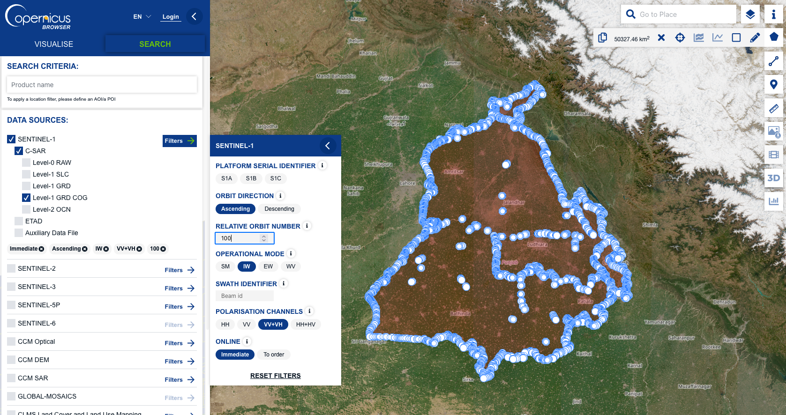


This will display a set of "slices" or tiles for the region of interest. Please download all the dates for a single tile and save them in a single directory in a format like this:

```
<root_directory>/
    s1/
        <orbit>/
            <row>/
                <slice>
                    S1A_*.tif
                    bounds_<row>_<slice>.geojson
```

For example, for there are 3 slices for relative orbit 100 in the image below: 6,5,4 (from top to bottom, with slice 6 highlighted in green). 

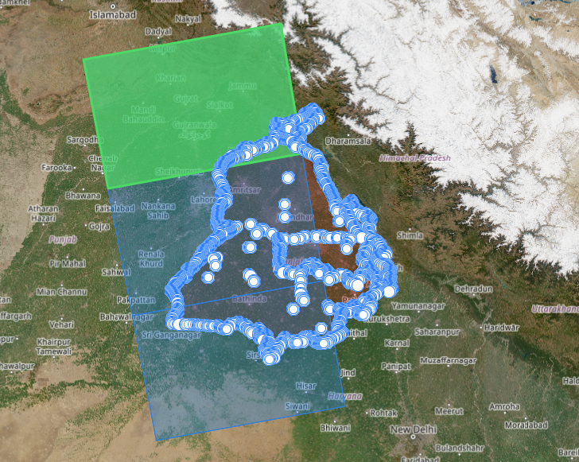

Therefore the directory structure should look like this so far:

```
<root_directory>/
    s1/
        ascending/
            100/
                6/
                    S1A_*.tif
                    bounds_100_6.geojson
                5/
                    S1A_*.tif
                    bounds_100_5.geojson
                4/
                    S1A_*.tif
                    bounds_100_4.geojson
```

This data organization is important during the SNAP preprocessing step, where we will process an entire slice worth of data at once.

Note: the bounds_*.geojson files are used to crop the S1 data to the valid region of the slice, since they dont always overlap with the full extent of the slice. For the Punjab slices, you can find the bounds in the `data/bounds` directory. These bounds files are not needed by SNAP, but are used during the tile processing step to remove the invalid regions.

## Processing Sentinel-1 data in SNAP

We will use the SNAP Toolbox to process the Sentinel-1 data. The following figure shows the processing steps:


### Step 1: Import data

Select all the S1A_*.tif files in a orbit-row-slice directory and drag them into SNAP.

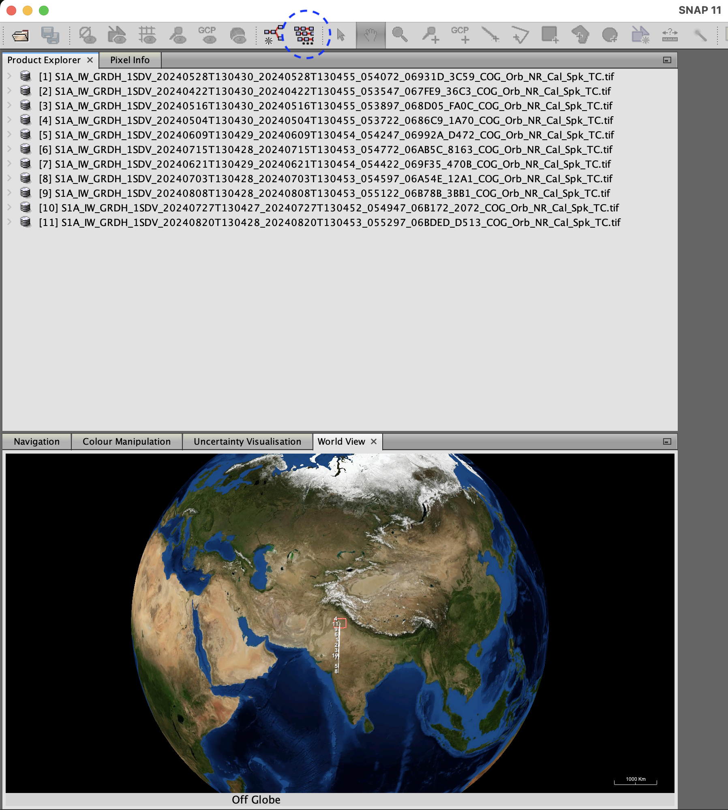


### Step 2: Batch processing

Click on the "Batch processing" icon in the top bar of SNAP. This will open the batch processing window. Hit the "add opened" button to add all the S1A_*.tif files in the orbit-row-slice directory to the batch processing window. Then "Load Graph" at the bottom and select the `static/s1-processing/S1_Gamm0_drop-MT.xml` file:


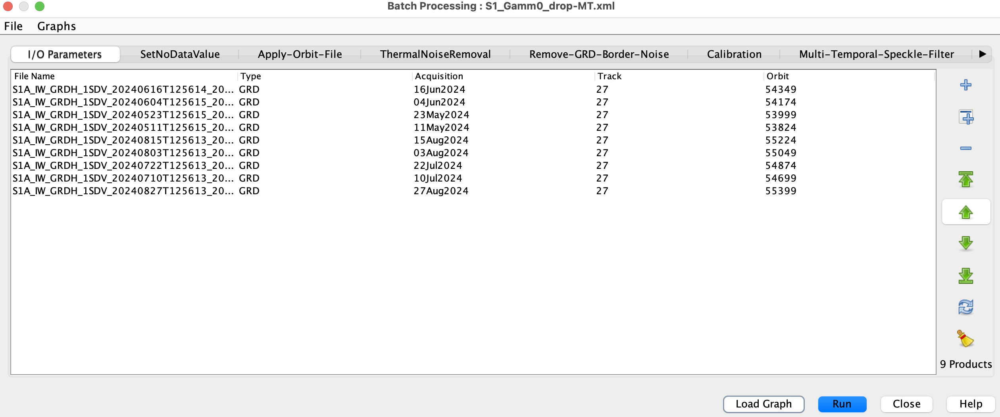


The graph essentially does the following:

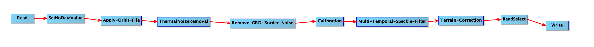

### Step 3: Ensure the correct parameters are set

The SNAP interface can be a little confusing and has some quirks. So its best to ensure the correct parameters are set, by clicking through the graph steps on the tab of this window. Here we document the steps and parameters that are important to ensure correctness for:

#### a. Apply orbit file

Make sure the "Do not fail if new orbit file is not found" checkbox is checked.

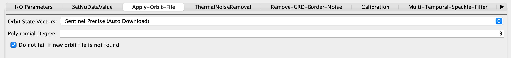

#### b. Thermal noise removal

Make sure the VV and VH bands are selected (use shift-click to select both).

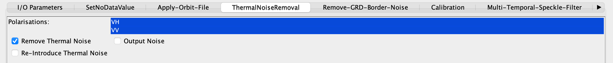

#### c. Remove GRD border noise

Make sure the VV and VH bands are selected (use shift-click to select both).

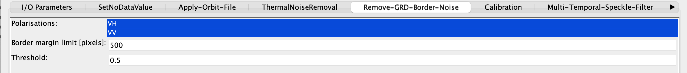

#### d. Calibration

Make sure the VV and VH bands are selected (use shift-click to select both), and "Output gamma0 band" is checked.

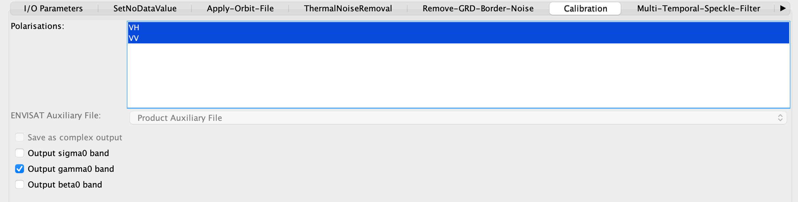

#### e. Multi-temporal speckle filtering

Make sure the Gamma0_VH and Gamma0_VV bands are selected (use shift-click to select both), and Filter is "Refined Lee".

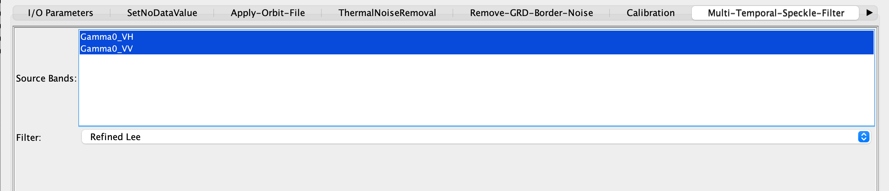

#### f. Terrain correction

Make sure the Gamma0_VH and Gamma0_VV bands are selected (use shift-click to select both), the others below:

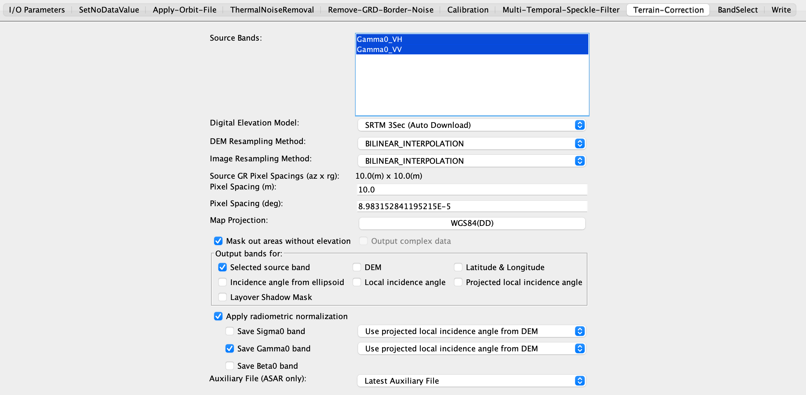

#### g. Band select

Make sure only the Gamma0_VH and Gamma0_VV bands are selected for "Source Bands" and the others are unchecked.

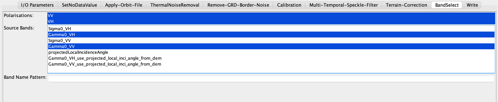

#### h. Write

Make sure "Save as" uses "GDAL-GTiff-Writer" and add the directory where the processed files will be saved.

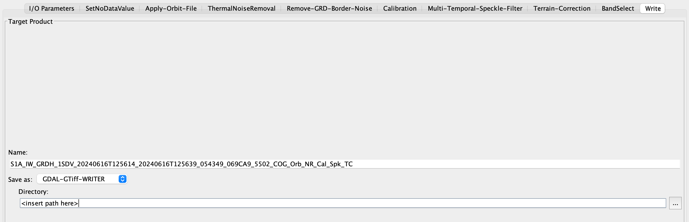


Now hit "Run" and it may take anywhere from 10 minutes to a few hours depending on the number of tiles you have.
